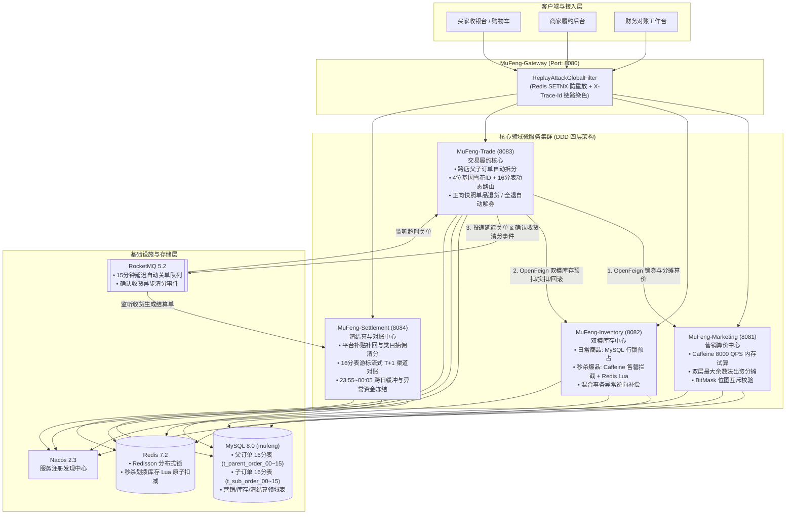

<div align="center">

# 🌌 木风 · 星枢 (MuFeng-StarNexus)
**基于 DDD 领域驱动设计的高并发分布式电商交易履约与清结算对账中台**

[](https://openjdk.org/)
[](https://spring.io/projects/spring-boot)
[](https://sca.aliyun.com/)
[](https://baomidou.com/)
[](https://rocketmq.apache.org/)
[]()

</div>

---

##  一、 项目背景与核心定位

在大型跨店电商大促场景下，传统 CRUD 电商系统普遍面临以下 **五大工程痛点**：
1. **高频算价打穿数据库**：大促期间用户频繁在购物车勾选商品试算优惠，海量并发读直接击穿 MySQL。
2. **跨店满减与多方出资尾差资损**：一张跨店满减券同时包含“平台补贴”与“商家让利”，除不尽时的 1 分钱尾差极易引发部分退货超退或商家少结。
3. **秒杀热点行锁争抢导致连接池雪崩**：爆款秒杀商品与长尾普通商品共用同一套库存扣减链路，热点 SKU 行锁阻塞拖垮全站交易。
4. **分库分表后的跨分片广播查询**：按 `user_id` 分表后，商家发货、支付回调仅携带 `order_no`，导致全库 16 张表广播扫描。
5. **T+1 渠道对账内存溢出与日切假阳性误报**：全量拉取订单表导致 OOM，且 `23:59:59` 支付跨天入账触发大量虚假短款告警。

**「木风-星枢（MuFeng-StarNexus）」** 严格采用 **DDD（领域驱动设计）四层架构**，围绕 **“零尾差算价分摊 -> 动静隔离双模库存 -> 基因法 16 分表父子拆单 -> 多方补贴清分与 T+1 游标对账”** 构建了一套完整的生产级资金与交易闭环。

---

##  二、 系统全景架构与工程模块划分

### 2.1 全链路业务与技术架构图



### 2.2 Maven 聚合工程模块说明

```text
MuFeng
├── MuFeng-Common        # [底座层] 4位基因雪花ID生成器、双层最大余数法工具、@DistributedLock AOP切面、全局异常处理
├── MuFeng-Api           # [契约层] 内部 OpenFeign 接口定义、跨服务 DTO、RocketMQ 领域事件契约
├── MuFeng-Gateway       # [网关层] Port: 8080 | WebFlux 响应式路由、X-Nonce 防重放攻击拦截、全链路 TraceId 透传
├── MuFeng-Marketing     # [营销域] Port: 8081 | 优惠券模板管理、Caffeine 本地缓存试算、平台/商家双层最大余数法分摊
├── MuFeng-Inventory     # [库存域] Port: 8082 | 动静隔离双模库存、秒杀库存划拨/回拨、Caffeine 售罄标记 + Redis Lua 原子预扣
├── MuFeng-Trade         # [交易域] Port: 8083 | 跨店父子拆单聚合根、单库16表基因动态路由、有限状态机、逆向部分退货
├── MuFeng-Settlement    # [清结算] Port: 8084 | 商家补贴清分与抽佣账单、16分片游标 T+1 对账、日切跨天缓冲池与资损自动冻结
└── docker               # [容器化] MySQL/Redis/Nacos/RocketMQ 编排配置与 39 张物理表初始化脚本
```

---

##  三、 五大核心架构设计详解

### 1. 营销算价中心：Caffeine 内存级试算与“双层最大余数法”零尾差引擎
* **8,000 QPS 零 DB 查询试算**：优惠券模板加载至 JVM 本地 `Caffeine Cache`，购物车高频勾选试算直接命中内存，支持指定券试算或**自动遍历用户券包推荐立减金额最大的最优券**。
* **双层最大余数法（Largest Remainder Method）**：所有金额统一使用 `Long`（单位：**分**），拒绝 `Double` 浮点精度丢失，通过 `ApportionUtil` 完成两级分摊并落盘至 `t_order_item_promo_snapshot`：
  1. **第一层（优惠额分摊至商品）**：将总优惠按各合格商品原价权重分摊，前 $N-1$ 件商品向下取整，**最后一件合格商品采用减法兜底（$\text{剩余待分摊额} = \text{总优惠} - \sum\text{前序已分摊}$）**。例如 3 件 `100.00元` 商品用满 300 减 `10.00元`（`1000分`）跨店券，精准分摊为 **`333分 / 333分 / 334分`**。
  2. **第二层（单品优惠拆解至出资方）**：按优惠券模板配置的 `platformSubsidyRatio`（万分比，如 `6667` 代表平台出资 `66.67%`），将每件商品的优惠额拆分为 **`platformSubsidyAmount`（平台补贴）** 与 **`merchantDiscountAmount`（商家让利）**，严格确保：
     $$\text{平台补贴} + \text{商家让利} \equiv \text{商品分摊总优惠}, \quad \text{商品原价} - \text{商品分摊总优惠} \equiv \text{买家实付}$$

### 2. 动静隔离双模库存中心：三级防线抗住 4,500 QPS 秒杀洪峰
针对日常长尾商品与大促秒杀商品的不同并发特征，在 `t_sku_inventory` 表物理隔离 `available_stock`（日常可用库存）与 `activity_frozen_stock`（秒杀划拨冻结库存）：
* **模式一（日常商品 `deductMode = 1`）**：走 MySQL 主键行锁原子预占（`available_stock - N, locked_stock + N`），强一致且链路极简。
* **模式二（秒杀爆品 `deductMode = 2`）**：运营提前调用 `/seckill/allocate` 将库存从 MySQL 划拨冻结至 Redis，提单时经过三级漏斗：
  1. **L1 本地内存拦截（0.01ms）**：检查 JVM `Caffeine` 中的 `localSoldOutCache`，一旦售罄直接内存拒绝 90% 溢出流量。
  2. **L2 Redis Lua 原子预扣（0.5ms）**：执行 `seckill_stock_deduct.lua`，在单次 Lua 脚本中原子完成 **`SISMEMBER` 一人一单防刷校验 + 库存充足性判断 + `DECRBY` 扣减 + `SADD` 记录已购用户**。当返回值刚好为 `0` 时，立即点亮 L1 本地售罄标记。
  3. **L3 混合事务逆向补偿**：若同一父订单中秒杀商品扣减 Redis 成功，但后续普通商品 MySQL 库存不足触发 `@Transactional` 回滚，应用层 `catch` 块自动捕获并执行 `seckill_stock_release.lua` 逆向回补 Redis 库存与清除限购标记，保证 DB 与 Redis 的严格原子性。

### 3. 交易履约核心：单库 16 分表“4位基因注入法”与跨店父子拆单
* **为什么采用“单库 16 分表”而非“多库分片”？**
  单库 16 张父订单分表（`t_parent_order_00 ~ 15`）+ 16 张子订单分表（`t_sub_order_00 ~ 15`）可轻松支撑 **1.6亿 ~ 3.2亿** 级订单规模，同时让同一用户的父订单与多个店铺子订单共享同一个 HikariCP 连接与本地 `@Transactional` 事务，**彻底规避引入 Seata XA/AT 分布式事务带来的 60% 性能损耗**。
* **64 位基因雪花算法（`GeneSnowflakeIdGenerator`）**：
  ```text
  | 1bit 符号位(0) | 41bit 毫秒时间戳 | 6bit 机器ID | 12bit 毫秒内自增序列 | 4bit 分表基因位 (userId & 15) |
  ```
  生成 `parentOrderNo` 和 `subOrderNo` 时，强制将 `userId` 的最低 4 位二进制嵌入订单号末 4 位。配合 MyBatis-Plus `DynamicTableNameInnerInterceptor` 动态表名拦截器，**无论是按 `userId` 查订单列表，还是仅凭 `parentOrderNo` / `subOrderNo` 查详情、支付回调、商家发货，均可直接通过 `(id & 15)` 在 $O(1)$ 时间内精准路由至唯一物理分表，实现 0 广播查询！**

### 4. 正向快照驱动的逆向部分退货与自动解券闭环
* 当买家对某个子订单中的单件商品发起退货退款（`/sub-order/refund-item`）时，系统直接读取提单时固化在 `t_order_item_promo_snapshot` 中的 `actual_pay_amount` 原路退回，无需重新逆向计算优惠分摊，彻底消除尾差争议。
* 每次单品退款后，系统自动检查同一父订单下的所有店铺子订单是否均已全额退完（`order_status == 60`）。一旦全部退完，自动通过 OpenFeign 调用营销中心 CAS 解锁归还用户的优惠券。

### 5. 多方补贴清分公式与 T+1 16分片游标对账/资损熔断
* **确认收货异步清分**：子订单确认收货后投递 `SubOrderSettledEvent`，清结算中心按以下公式自动生成商家结算单（`t_merchant_settlement_bill`）：
  $$\text{商家最终应结净额} = \underbrace{(\text{买家实付净额} + \text{平台出资补贴补回})}_{\text{商家实际营收基数}} - \text{平台类目抽佣 (5\%)}$$
* **16 分表游标对账与日切跨天缓冲池**：
  * 对账引擎按 `_00 ~ _15` 逐片流式拉取指定账期日的父订单流水与渠道账单双向比对，避免大结果集内存溢出。
  * **日切缓冲机制（`23:55:00 ~ 00:05:00`）**：落入午夜日切窗口的疑似短款单自动归入 `CROSS_DAY_BUFFER (0)` 挂起待次日复核，消除 99% 假阳性误报。
  * **防资损自动熔断**：一旦识别出真实的 `SHORT_BILL`（短款）或 `AMOUNT_MISMATCH`（金额不符），立即自动将该父订单关联的所有商家待打款结算单状态更新为 **`4-对账异常冻结`**，拦截资金外流。

---

##  四、 数据库表结构全景（单库 39 张物理表）

数据库名：`mufeng`（初始化脚本位于 `docker/sql/init_schema.sql`）：

| 所属领域 | 物理表名 | 分表策略 | 核心并发与幂等机制 |
| :--- | :--- | :---: | :--- |
| **营销算价域** | `t_coupon_template` | 单表 | `available_stock > 0` 行锁防超发 + Caffeine 本地缓存 |
| **营销算价域** | `t_user_coupon` | 单表 | `@DistributedLock` 防刷限领 + `status` CAS 状态机锁券/解券 |
| **双模库存域** | `t_sku_inventory` | 单表 | 日常可用/锁定库存与秒杀划拨冻结库存物理字段隔离 |
| **双模库存域** | `t_inventory_deduct_log` | 单表 | `uk_order_sku (sub_order_no, sku_id)` 唯一索引防重扣减流水 |
| **交易履约域** | `t_parent_order_00 ~ _15` | **16 分表** | 末 4 位基因路由 + `order_status` CAS 幂等状态推进 |
| **交易履约域** | `t_sub_order_00 ~ _15` | **16 分表** | 按店铺拆分独立履约 + `(refunded_amount + refund) <= sub_pay_amount` 防超退 |
| **交易履约域** | `t_order_item_promo_snapshot` | 单表 | 固化商品级最大余数法分摊结果与平台/商家出资快照 |
| **清结算对账域** | `t_merchant_settlement_bill` | 单表 | `uk_sub_order (sub_order_no)` 唯一索引确保 MQ 消费幂等 |
| **清结算对账域** | `t_reconciliation_diff` | 单表 | 记录跨日缓冲挂起单、长款、短款、金额不符差错明细 |

---

##  五、 本地快速启动

### 5.1 环境准备与中间件一键启动
1. **初始化 MySQL 数据库**：在本地 MySQL 8.0（默认密码 `123456`）中执行 `docker/sql/init_schema.sql`，自动创建 `mufeng` 库及 39 张表。
2. **启动 Redis / Nacos / RocketMQ 容器**：
   ```bash
   cd docker
   docker compose up -d nacos rmqnamesrv rmqbroker
   ```
3. **启动微服务集群**：在 IDE 中依次运行以下 5 个启动类：
   * `MarketingApplication` (`8081`)
   * `InventoryApplication` (`8082`)
   * `TradeApplication` (`8083`)
   * `SettlementApplication` (`8084`)
   * `GatewayApplication` (`8080`)
